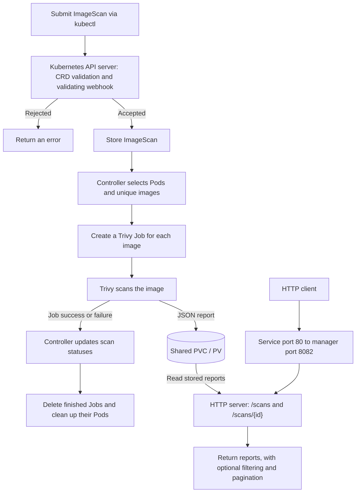

# ImageScan Kubernetes Operator

A Kubernetes operator built with Go, Kubebuilder, and controller-runtime. It accepts a cluster-scoped `ImageScan` request, selects Pods by namespace and Pod labels, and runs a Trivy Job for each unique container image. Reports are stored on a persistent volume and exposed through an HTTP API.

The implementation covers request validation, asynchronous scan execution, per-image and overall status, persistent reports, and Job cleanup. Additional features include severity selection, image-prefix filtering, and pagination.

## 1. Architecture overview

The controller, validating webhook, and report HTTP server run in the same manager process. Trivy runs separately in the Pods created by scan Jobs.



Report storage is independent of Job cleanup. The HTTP server reads existing reports on request; it does not wait for all scans to finish.

## 2. Development environment and project setup

Development takes place in Ubuntu under WSL2, using Docker Desktop and VS Code. The local Kind cluster is named `kind`; its kubectl context is `kind-kind`, and its node is `kind-control-plane`.

These environment versions were recorded on **28 October 2026**:

| Component | Version |
|---|---|
| Ubuntu | 24.04.5 LTS |
| Go | 1.26.0 |
| Kind | 0.33.0 |
| Git | 2.43.0 |
| kubectl | 1.36.1 |
| Kubernetes node | 1.37.0 |
| Kubebuilder | 4.16.0 |
| Docker Desktop | 4.93.0 |
| cert-manager | 1.21.1 |

Scan Jobs use `aquasec/trivy:0.76.1`. The debug Dockerfile installs Delve `1.27.2` inside the image.

The initial setup used the following steps. Cluster creation changes Docker resources and kubeconfig; the Kubebuilder commands generate local project files and do not deploy the operator. They are setup steps, not commands to rerun in the existing project.

```bash
kind create cluster 
kubebuilder init
# Generate API types and a controller scaffold for the cluster-scoped ImageScan resource.
kubebuilder create api --group scan --version v1 --kind ImageScan --resource=true --controller=true --namespaced=false

# Generate a validating webhook scaffold for the existing ImageScan API.
kubebuilder create webhook --group scan --version v1 --kind ImageScan --programmatic-validation
```
<!--
`kubebuilder init` creates the Go module, manager entry point, Makefile, and configuration structure. The project's configured domain is `my.domain`, giving the API group/version `scan.my.domain/v1`. `--namespaced=false` makes ImageScan a cluster-scoped resource, allowing one request to select workloads across namespaces. -->

## 3. Implementation

### 3.1. API types

Implementation started in `api/v1/imagescan_types.go`, establishing the API contract used by both the webhook and controller.

| Type | Responsibility |
|---|---|
| `ImageScanSpec` | Namespace and Pod label selectors, BONUS Task: severity selection |
| `ScanPhase` | The scan lifecycle: `Pending`, `Running`, `Completed`, or `Failed` |
| `ImageScanResult` | ID, image reference, phase, and optional message for one image |
| `ImageScanStatus` | Overall phase and the list of individual scan results |
| `ImageScan` / `ImageScanList` | Kubernetes resource and list types |

The CRD makes `spec` immutable after creation and exposes a status subresource. A new selection or scan requires a new ImageScan. Empty selectors match all resources in their respective scope.

### 3.2. Admission validation

`internal/webhook/v1/imagescan_webhook.go` registers the validator with the manager. On creation, it validates both selectors and requires at least one matching Pod in a selected namespace. It uses `mgr.GetAPIReader()` to query the API server directly rather than relying on the manager's cache.

`ValidateUpdate` is unused for further checks: the CRD already prevents changes to `spec`. `ValidateDelete` also is not used.

### 3.3. Reconciliation and Trivy Jobs

The main workflow is in `internal/controller/imagescan_controller.go`:

1. **Read the request.** Fetch ImageScan by name.
2. **Discover images once.** When no phase is saved, select Namespaces and Pods, then collect unique image <!--references from regular, init, and ephemeral containers. -->
3. **Persist scan entries.** Assign each image an ID based on the ImageScan UID and an index, and save its initial `Pending` phase.
4. **Create or inspect Jobs.** For each unfinished entry, read its Job or create one if missing. Each Job runs Trivy and writes `/reports/<scan-ID>.json` to the shared PVC.
    - BONUS Task include severity if such is provided in ImageScan.
5. **Update status and clean up.** Read Job conditions, save changed individual and overall phases, then delete Jobs for completed or failed entries. Background deletion( enabled garbage collection) lets Kubernetes also remove their Pods.

The controller watches ImageScan resources and owned Jobs through `.Owns(&batchv1.Job{})`. Owner references connect Job events to the corresponding request. Later events trigger another pass.

### 3.4. Individual and overall status

These phases belong to ImageScan, rather than being copies of kubectl's Pod `STATUS` column:

| Phase | Meaning in this implementation |
|---|---|
| `Pending` | The image entry is initialized and awaiting processing |
| `Running` | The Job exists, its "in progress" |
| `Completed` | The Job reports `job.Status.Conditions  --> Complete=True` |
| `Failed` | The Job reports `job.Status.Conditions  --> Failed=True` |

Individual phases are stored in `status.scans[].phase`. `overallScanPhase` sets `status.phase`: One failed scan takes sets overall phase to Failed; otherwise, all completed scans yield `Completed`, an active scan yields `Running`, and the remaining state is `Pending`.
<!--
Finding vulnerabilities does not itself mean failure. The controller derives completion from Job conditions; it does not independently validate the report file. Job creation errors are recorded in the entry's message and returned for retry.
-->
### 3.5. Persistent reports

PV `imagescan-results-pv` provides `/var/local/imagescan-results` on the local Kind node. PVC `imagescan-results-pvc`, in namespace `imagescan-project-system`, binds to that volume.

- Trivy Pods mount the PVC at `/reports` for writing JSON reports.
- The manager Pod mounts the same PVC at `/reports` **read-only**, as configured in `config/manager/manager.yaml`.
- Both access the storage independently.

The reports survive Job deletion because the PVC is separate from the Job lifecycle. 

### 3.6. HTTP report API

`cmd/main.go` registers an HTTP server with the manager, using Go's standard library. It listens on `:8082` and reads reports from the manager container's `/reports` mount. Keeping it in the existing process avoids a separate Deployment for report delivery.

| Endpoint | Response |
|---|---|
| `GET /scans/{id}` | The original Trivy JSON report|
| `GET /scans` | A list of objects containing `scanID` and `report` |
| `GET /scans?imagePrefix=nginx` | Reports filtered by the prefix of `ArtifactName` |
| `GET /scans?limit=2&offset=0` | BONUS Task: A page of results; defaults are `limit=20`, `offset=0` |

The ClusterIP Service `scan_results_service.yaml` selects manager Pods by their labels and maps **Service port 80 to Pod port 8082**. This target port matches the HTTP server's `Addr` in `cmd/main.go`.

## 4. Deployment configuration and fixes

The main configuration changes connect the application code to its runtime dependencies:

| File | Change and purpose |
|---|---|
| `config/default/kustomization.yaml` | Sets namespace and resource prefix, enables webhook/cert-manager resources and patches, and includes the report Service |
| `config/manager/kustomization.yaml` | Selects the operator image used by the Deployment |
| `config/manager/manager.yaml` | Mounts reports read-only and sets the manager's resource limits |
| `config/default/scan_results_service.yaml` | Exposes the report server through port 80 to target port 8082 |
| `config/certmanager/certificate-webhook.yaml` | Replaces placeholder certificate DNS names with the actual webhook Service names |
| `config/manager/dev-mode-patch.yaml` and `debug-mode-patch.yaml` | Switch the installed Deployment between normal execution and debugging |
| `Dockerfile.debug` and `Makefile` | Add Delve and commands to build, load, patch, and restart the local operator |

RBAC permissions are declared in controller markers. CRD, RBAC, webhook manifests, and DeepCopy code are generated with `make manifests` and `make generate`, rather than edited directly.

## 5. Development checks and CI

| Command | Purpose |
|---|---|
| `make manifests` | Regenerate CRD, RBAC, and webhook manifests |
| `make generate` | Regenerate DeepCopy methods |
| `make lint-fix` | Apply automated style fixes |
| `make test` | Run tests with envtest; also runs generation, formatting, and vet |
| `go build ./...` | Check package compilation |


## 6. Local deployment and demonstration

Run commands from the project directory in Ubuntu. Deployment requires cert-manager and a bound `imagescan-results-pvc` in `imagescan-project-system`; the default Kustomize build does not provision this PVC.

In another terminal, open a local tunnel to the report server. This selects a Pod through the Service and forwards local port `8080` to that Pod's target port `8082`, without changing Kubernetes resources:

```bash
kubectl -n imagescan-project-system port-forward \
  service/imagescan-project-scan-results-service 8080:80 --address 127.0.0.1
```

Use GET requests to demonstrate listing, filtering, pagination, and individual report retrieval. Replace `REAL_SCAN_ID` with an ID from `status.scans`:

```bash
curl 'http://127.0.0.1:8080/scans'
curl 'http://127.0.0.1:8080/scans?imagePrefix=nginx&limit=2&offset=0'
curl 'http://127.0.0.1:8080/scans/REAL_SCAN_ID'
```
